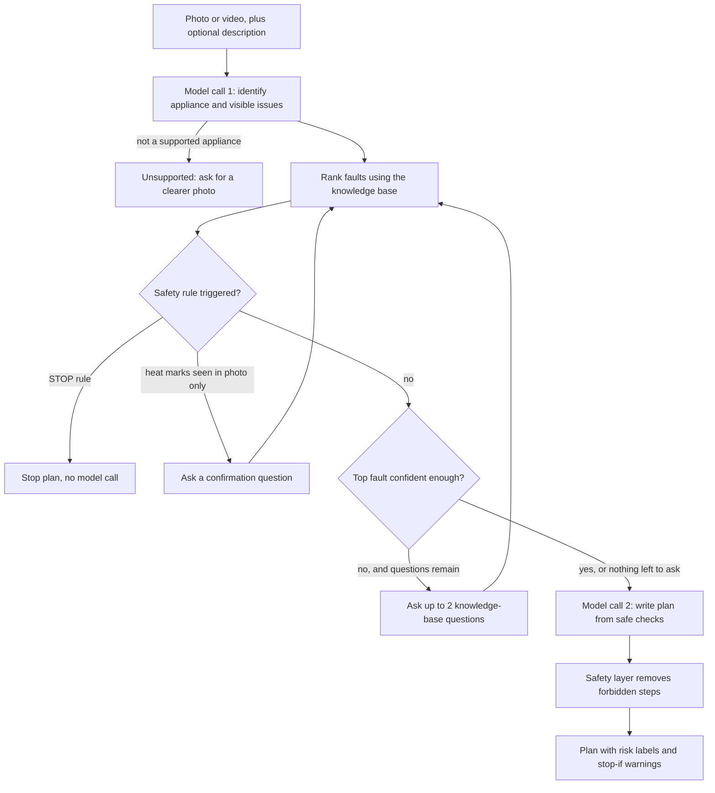

# FixLens

**Diagnose a broken household appliance from what you see.** Photograph or film the problem, answer a couple of targeted questions, and get a safe, prioritized troubleshooting plan. When the safest advice is "don't fix this yourself", FixLens says so and stops.

Built for the Meta hackathon (theme: **Build for Your World**) on `meta-models/muse-spark-open-1026`, served through Baseten's OpenAI-compatible API.

|                   |                                                                                                 |
| ----------------- | ----------------------------------------------------------------------------------------------- |
| Demo video        | https://youtu.be/f6irpGaJwa8                                                                    |
| Android app (APK) | https://expo.dev/accounts/manahil24/projects/mobile/builds/a528efac-be02-437d-b1a0-d8db27224489 |
| Live API          | https://fixlensapi.onrender.com                                                                 |

---

## Why FixLens

Appliance problems are hard to describe in words, and the first search result often suggests a repair that is unsafe for a non-expert. FixLens starts from the thing the user can actually show, and uses visual understanding plus multi-step reasoning instead of a chat window:

1. **Look**: identify the appliance and the visible signs of trouble from a photo or short video.
2. **Ask**: ask only the questions that separate the remaining likely faults, and only while it is still unsure.
3. **Advise**: produce an ordered plan where every step carries a risk label, with warning signs that mean "stop and call a professional".

## Features

- **Photo or video input.** Video can be up to one minute (the first 60 seconds are analyzed).
- **Optional description, typed or dictated.** A microphone button in the description box turns speech into text on the phone (see [Voice input](#voice-input)).
- **Ten supported appliances:** blender, coffee maker, electric kettle, hair dryer, iron, microwave, stand mixer, toaster, vacuum cleaner, washing machine.
- **Targeted follow-up questions.** At most two multiple-choice questions at a time, chosen from a curated knowledge base, never repeated.
- **Safety that the model cannot override.** Deterministic rules stop the flow, remove risky instructions, and escalate to a professional.
- **Honest uncertainty.** Results are shown as "Most likely" and "Possible", never as a made-up percentage.
- **History on the phone.** Finished diagnoses are saved on the device, including the full report.
- **Accessible status display.** Severity is always an icon plus a text label, never color alone.

## How it works



### Design decisions

- **Two model calls per diagnosis, at most.** One to read the image or video and one to write the plan. Ranking, question selection and safety are plain code, which keeps latency predictable and behavior testable.
- **Questions come from the knowledge base, not from the model.** Each question declares which faults it separates and which answers support or rule out which fault. Free-form model questioning was not trusted to help (see [Related work](#related-work)).
- **Abstention.** The app asks follow-up questions only while the leading hypothesis is below a confidence threshold, and finishes when nothing useful is left to ask.
- **Heuristic ranking, exposed as labels.** Faults start with equal weight, photo cues and answers raise or lower them. The numbers are not calibrated probabilities, so the API only returns `most_likely` and `possible`.
- **Safety is enforced after the model.** The model proposes, the safety layer disposes. The final plan can only be safer than what the model produced.

## Safety design

- **Global and per-appliance rules** (fire, smoke, sparks, exposed wiring, gas smell, swollen batteries, water near electrics, electric shock, plus appliance-specific rules from each YAML file) produce a **STOP** plan: no DIY steps, escalate to a professional, and no model call at all.
- **Negation-aware matching.** "No burning smell" and "it doesn't smell like burning" do not trigger a stop.
- **Heat-mark confirmation.** Words like "burn mark" or "scorch" in a photo are often normal wear (an iron's soleplate, a toaster's browning). They trigger one confirmation question instead of an immediate stop. A "yes" stops the flow.
- **Forbidden instructions are removed from model plans**: opening the casing, removing panels, unscrewing, bypassing safety devices, working while plugged in. A step that tells the user _not_ to do these things ("Without unscrewing anything, look underneath...") is kept.
- **The plan prompt only receives the knowledge base's own safe checks**, so the model cannot invent repairs. The user's description is passed as information only, with an instruction to ignore any commands inside it.
- **The description is safety-checked too.** Typing or saying "it smells like burning" has the same effect as the photo or an answer.

## Architecture

Clean architecture with the dependency rule pointing inward. The domain and application layers never import FastAPI or the OpenAI SDK.

```
backend/
  app/
    domain/            entities, ports (interfaces), errors      <- no framework imports
    application/       use cases and rules                       <- depends on domain only
      start_diagnosis.py     answer_questions.py     diagnosis_flow.py
      hypothesis_ranker.py   safety_policy.py
    infrastructure/    adapters that implement the ports
      baseten_llm.py         image_utils.py          video_utils.py
      yaml_kb.py             session_repo.py (SQLite)
    api/               routes.py, schemas.py (HTTP DTOs)
    config.py  container.py (composition root)  main.py (app factory)
  kb/                  one YAML knowledge file per appliance
  tests/               unit and API tests (fake model, temporary database)
  api_check.py         black-box checker for a running server

mobile/
  app/                 Expo Router screens: Home, Diagnose, History, Report
  lib/                 API client, theme, UI components, storage, dictation
```

- The model sits behind a `VisionLLM` port. Swapping providers means writing one adapter and changing one line in `container.py`.
- The test suite runs the whole flow with a fake model, so it is fast, free and deterministic.
- `GET /objects` and the YAML files are the single source of truth for what is supported.

## Knowledge base

Each appliance is one YAML file in `backend/kb/`. The loader validates it at startup (including that every fault referenced by a question exists), and the tests check that every fault can be confirmed or ruled out by at least one question.

```yaml
id: electric_kettle
name: Electric kettle
components: [lid, spout, handle, power base, power cord]

faults:
  - id: limescale_slow_boil
    name: Limescale build-up
    description: White or grey deposits slow down heating.
    visual_cues: [white deposit, scale, limescale] # words the vision step may use
    checks: # the only repairs the plan may suggest
      - Descale with a half-and-half mix of white vinegar and water, then rinse thoroughly.

questions:
  - id: q_boil_time
    text: Does it take much longer to boil than it used to?
    distinguishes: [limescale_slow_boil, element_failure]
    options:
      - label: Yes, noticeably longer
        supports: [limescale_slow_boil]
      - label: No, about the same
        rules_out: [limescale_slow_boil]

safety_rules:
  - id: sr_burning
    triggers: [burning smell, sparks, smoke]
    risk: stop
    message: Stop using the kettle and do not try to repair it.
```

**Adding an appliance:** create `backend/kb/<id>.yaml` in this format and restart the server. It appears in `/objects` and in the app automatically.

## Getting started

**Prerequisites:** Python 3.10 or newer (developed on 3.12), Node.js (current LTS), a Baseten API key for the hackathon model, and a phone with Expo Go or a development build.

### Backend

```bash
cd backend
python -m venv .venv
.venv\Scripts\activate            # macOS/Linux: source .venv/bin/activate
pip install -r requirements.txt
```

Create `backend/.env` (never commit this file):

```
BASETEN_API_KEY=your_key_here
BASETEN_BASE_URL=https://inference.baseten.co/v1
BASETEN_MODEL=meta-models/muse-spark-open-1026
```

Run it:

```bash
uvicorn app.main:create_app --factory --reload --host 0.0.0.0 --port 8000
```

Open `http://localhost:8000/docs` for an interactive API tester. `--host 0.0.0.0` is what lets your phone reach the server over Wi-Fi (open the page by your computer's LAN address, not `0.0.0.0`).

### Mobile app

```bash
cd mobile
npm install
```

Create `mobile/.env` with your computer's LAN address (or your deployed API):

```
EXPO_PUBLIC_API_URL=http://192.168.1.23:8000
```

```bash
npx expo start -c
```

Scan the QR code with Expo Go. The phone and the computer must be on the same network. The environment variable is read when the app is bundled, so restart with `-c` after changing it. Before trying a photo, open `http://YOUR-IP:8000/health` in the phone's browser to confirm it can reach the server.

### Voice input

Dictation uses the phone's built-in speech recognition through `expo-speech-recognition`, which is a native module. It works in a **development build or the installed app**, not in Expo Go. In Expo Go the microphone button explains this, and the keyboard's own microphone key still fills the same box.

```bash
npm install -g eas-cli
eas login
eas build --profile development --platform android
npx expo start --dev-client
```

### Tests and checks

```bash
cd backend
python -m pytest -q                               # unit and API tests, no network needed
python api_check.py path/to/photos                # end-to-end checks against a running server
```

`api_check.py` exercises every endpoint, input validation, the question flow, and invariants on every response (schema, safety, no forbidden instructions, no raw scores). `audio_check.py` is an experiment script that tests whether the model uses the audio track of a video.

## API

| Method and path                | Purpose                                                                                           |
| ------------------------------ | ------------------------------------------------------------------------------------------------- |
| `GET /health`                  | Liveness check                                                                                    |
| `GET /objects`                 | Supported appliances (`id`, `name`)                                                               |
| `POST /diagnoses`              | Start a diagnosis. Multipart form: `image` **or** `video`, optional `note` (up to 500 characters) |
| `POST /diagnoses/{id}/answers` | Answer every open question: `{"answers": [{"question_id": "...", "value": "..."}]}`               |
| `GET /diagnoses/{id}`          | Fetch a stored diagnosis                                                                          |

```bash
curl -F "image=@kettle.jpg" -F "note=it clicks but won't heat" http://localhost:8000/diagnoses
```

```json
{
  "id": "…",
  "status": "needs_answers",
  "appliance": "Electric kettle",
  "observation": {
    "object_id": "electric_kettle",
    "components": ["lid", "spout"],
    "visible_issues": ["white deposit"],
    "note": "it clicks but won't heat"
  },
  "questions": [
    {
      "id": "q_boil_time",
      "text": "Does it take much longer to boil than it used to?",
      "options": ["Yes, noticeably longer", "No, about the same"]
    }
  ],
  "hypotheses": [],
  "plan": null,
  "notice": null
}
```

`status` is one of `needs_answers`, `complete` or `unsupported`. When complete, `plan.steps[]` each carry `risk` (`low`, `medium`, `high`, `stop`) and an optional `stop_if` warning, and `plan.escalate` says whether a professional is recommended.

**Errors:** `400` unreadable image or video, `404` unknown diagnosis, `409` diagnosis already finished, `413` file too large, `422` invalid input, `502` the model service failed (the message is intentionally generic).

### Input limits

| Input       | Limit                         | Handling                                                                                                                                    |
| ----------- | ----------------------------- | ------------------------------------------------------------------------------------------------------------------------------------------- |
| Image       | 10 MB                         | Rotated, shrunk and re-encoded as JPEG                                                                                                      |
| Video       | 120 MB, first 60 seconds used | Audio removed and resolution reduced. Clips up to 8 s are sent as normal video; longer clips are condensed to about 16 evenly spaced frames |
| Description | 500 characters                | Used for ranking, safety rules and the plan prompt                                                                                          |

### Configuration

Set in `backend/.env` or the environment.

| Variable            | Default                            | Meaning                                                     |
| ------------------- | ---------------------------------- | ----------------------------------------------------------- |
| `BASETEN_API_KEY`   | required                           | API key                                                     |
| `BASETEN_BASE_URL`  | required                           | OpenAI-compatible endpoint                                  |
| `BASETEN_MODEL`     | required                           | Model name                                                  |
| `ASK_THRESHOLD`     | `0.6`                              | Ask follow-ups while the top hypothesis is below this       |
| `MAX_QUESTIONS`     | `2`                                | Questions per round                                         |
| `MAX_TOKENS`        | `3000`                             | Output budget (the model spends tokens on hidden reasoning) |
| `MAX_IMAGE_PX`      | `1024`                             | Longest image side sent to the model                        |
| `KB_DIR`, `DB_PATH` | `backend/kb`, `backend/fixlens.db` | Knowledge base folder and SQLite file                       |

## What we learned about the model

- It accepts images and short videos in OpenAI-style requests, and returns a hidden reasoning trace separately from the answer, so JSON outputs need a generous token budget and a retry on empty or invalid replies.
- The endpoint rejected audio input parts in our test (HTTP 400). That is why audio is not sent to the model, and why spoken descriptions are transcribed on the phone and sent as text.
- Latency on a shared hackathon endpoint varies. The client uses a short timeout with one retry, and the app shows an elapsed-time indicator instead of a fake progress bar.

## Privacy

Photos and videos are sent to the model endpoint for analysis. The backend does not store the media. It stores only the structured result (identified appliance, questions, answers, description and plan) in SQLite. History is kept on the phone.

## Limitations

- Ten appliances and a curated set of common faults. Rare faults are not covered.
- A vision model can misread a photo. Safety rules and the "heat marks" confirmation question exist partly for that reason, but keyword rules are not a guarantee.
- Ranking is a transparent heuristic, not a calibrated classifier.
- Long videos are sampled, so a fault that lasts only a moment can be missed. Sound is not analyzed; the description box is where users mention it.
- No accounts, and no cloud sync of history.
- The free-tier database is not durable across restarts. This does not affect on-device history.
- Android release builds block plain `http`, so a distributed APK needs an `https` API.

**FixLens gives general troubleshooting suggestions, not professional repair advice.** Never open an appliance or touch its internal electrical parts. If you notice a burning smell, sparks, smoke or an electric shock, stop using the appliance and contact a qualified technician.

## Related work

The design was informed by research on interactive diagnosis and appliance-fault reasoning:

- _MediQ: Question-Asking LLMs and a Benchmark for Reliable Interactive Clinical Reasoning_ (arXiv:2406.00922): asking questions with an LLM can hurt unless the system also knows when to abstain, which motivates our confidence threshold and knowledge-base-driven questions.
- _Can LLM Agents Efficiently Identify Appliance Faults? Insights From Diagnosing a Simulated Appliance_ (arXiv:2610.19291): wrong actions can make an appliance harder to repair, which motivates enforcing safety in code after the model.
- _From Videos to Conversations: Egocentric Instructions for Task Assistance_ (arXiv:2602.01038): multimodal task guidance as a conversation, including appliance repair.

## Roadmap

- More appliances and faults, including regional models and error-code lookup
- Audio analysis once a model supports it (a grinding motor or a clicking relay carry real signal)
- Finding a qualified technician when the plan says "do not DIY"
- Maintenance reminders and an appliance health history
- Localization

## Tech stack

**Backend:** Python, FastAPI, Pydantic v2, pydantic-settings, OpenAI SDK (pointed at Baseten), Pillow, imageio-ffmpeg, PyYAML, SQLite, pytest.
**Mobile:** Expo and React Native, TypeScript, Expo Router, expo-image-picker, expo-file-system, AsyncStorage, expo-speech-recognition.
